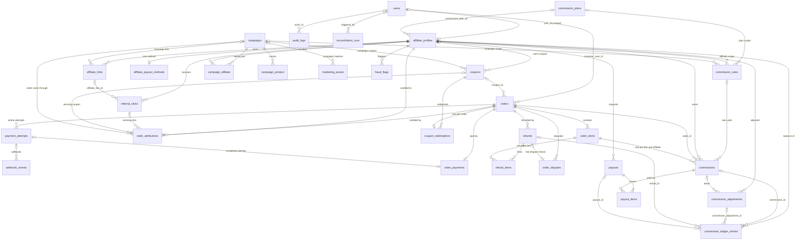

# Database schema

This document is generated from the migrations in `database/migrations/` as they exist now, plus the status values in `app/Enums/`. It is not taken from `docs/phase-0-plan.md`, which was an early design and differs from what was built. For example, the plan's `referral_links` table was built as `affiliate_links`.

Conventions used throughout:

- **Ids.** Every table has an auto-increment `id` that stays inside the server. Tables exposed through the API also have `public_id` (a ULID, with a unique index), which is used in URLs and responses.
- **Money.** Amounts are `*_minor` columns holding unsigned integers in paisa, alongside a `currency` column (`CHAR(3)`, `NPR` by default). The only signed amount is `commission_adjustments.amount_minor`. Rates are basis points (`rate_bp`).
- **Statuses.** Status columns are `VARCHAR` values cast to PHP enums. The allowed values listed below come from `app/Enums`.
- **Time.** Timestamps are stored in UTC.
- **Append-only tables.** Their models throw a `LogicException` on update or delete. Where noted, other models freeze only some of their columns.

## ER diagram (money and attribution)

The diagram omits audit and actor links to `users` (columns such as `approved_by`, `confirmed_by`, `decided_by`, `created_by` and `reviewed_by`), except the ones that matter for ownership.

Cardinality notation: `||` means exactly one, `|o` and `o|` mean zero or one, `o{` means zero or more, and `|{` means one or more. A `||` on the parent side means the foreign key is `NOT NULL`. A `|o` means the foreign key is nullable.

## Users, access and audit

### `users`
The account for everyone: customers, affiliates and staff.
- Columns: `public_id` (ULID, unique), `name`, `email` (unique), `phone` (E.164, nullable), `email_verified_at`, `password`, `status` (`active` or `disabled`, `UserStatus`, indexed), `last_login_at`, `remember_token`, timestamps, `deleted_at` (soft deletes).
- Invariants: a `disabled` user is refused by the `active` middleware even if they hold a valid token. Roles (`super_admin`, `affiliate_manager`, `finance_manager`, `support`, `affiliate`, `customer`) live in the permission tables, not on this table.

### `audit_logs` (append-only)
- Columns: `actor_id` (users, nullable, set null on delete), `action` (100), `subject_type`, `subject_id` (64), `properties` (JSON, secrets redacted), `ip_hash` (`CHAR(64)`, an HMAC of the IP, not the address), `user_agent`, `created_at` (there is no `updated_at`).
- Indexes: `(subject_type, subject_id)`, `(actor_id, created_at)`, `(action, created_at)`.
- Invariants: the model throws on update or delete. In production, the database user should have only `INSERT` and `SELECT` on this table.

## Affiliates

### `affiliate_profiles`
One affiliate membership per user.
- Columns: `public_id` (unique), `user_id` (unique, restrict on delete), `status` (`AffiliateStatus`: `pending`, `approved`, `rejected`, `suspended`, `deactivated`; indexed), `commission_plan_id` (nullable, set null on delete), `display_name`, `referral_code` (16, unique, nullable), `referral_slug` (60, unique, nullable), `country_code` (default `NP`), `city`, `address_line`, `promotion_channels` (JSON of `PromotionChannel` values), `website_urls` (JSON), `audience_description`, `applied_at`, `approved_at`, `approved_by`, `status_changed_at`.
- Indexes: `(status, applied_at)`.
- Invariants: `referral_code` and `referral_slug` are assigned at the first approval and never reused.

### Membership support tables
- `affiliate_status_histories` (**append-only**): `affiliate_profile_id`, `from_status`, `to_status`, `actor_id`, `public_reason` (shown to the member), `internal_note` (staff only), `created_at`. Indexed on `(affiliate_profile_id, created_at)`.
- `affiliate_terms_versions`: `version` (unique), `title`, `body`, `published_by`, `published_at` (indexed). The model refuses updates, so a change means publishing a new version.
- `affiliate_terms_acceptances`: `affiliate_profile_id`, `terms_version_id` (restrict on delete), `accepted_at`, `ip_hash`, `user_agent`. Unique on `(affiliate_profile_id, terms_version_id)` (`terms_acceptance_unique`).
- `affiliate_notes`: staff-only notes (`affiliate_profile_id`, `author_id`, `body`, `created_at`).

## Referral tracking and attribution

### `affiliate_links`
Named tracking links (called `referral_links` in the phase 0 plan).
- Columns: `public_id` (unique), `affiliate_profile_id` (cascade on delete), `name`, `slug` (60), `product_id` (nullable), `utm_source`, `utm_medium`, `utm_campaign`, `is_active`, `campaign_id` (nullable, restrict on delete; added in 1.1.0).
- Unique: `(affiliate_profile_id, slug)`. The slug is permanent, so it cannot be changed through the API.

### `referral_clicks`
One minimised row per counted click on `/ref/{code}/{link?}`.
- Columns: `public_id` (unique), `affiliate_profile_id` (cascade), `affiliate_link_id` (nullable, set null on delete), `product_id`, `landing_path`, `referrer_host`, `utm_source`, `utm_medium`, `utm_campaign`, `sub_id`, `visitor_hash` and `ip_hash` (`CHAR(64)` hashes, never raw values), `is_unique` (default true), `set_attribution` (default true), `created_at` (there is no `updated_at`).
- Indexes: `created_at`, `(affiliate_profile_id, created_at)`, `(visitor_hash, affiliate_profile_id, created_at)` (`referral_clicks_visitor_lookup`), `(created_at, affiliate_profile_id, is_unique)` (reporting).
- Invariants: rows are pruned by `affiliate:prune-referral-data` according to the retention settings.

### `order_attributions`
The affiliate credited for an order.
- Columns: `order_id` (**unique**, cascade), `affiliate_profile_id` (restrict), `source` (`AttributionSource`: `click`, `coupon`, `referral_code`, `manual`), `referral_click_id` (nullable), `coupon_id` (nullable), `policy` (20), `window_days`, `clicked_at`, `decided_by`, `reason`, `campaign_id` (nullable, restrict; added in 1.1.0: the campaign the order came through, set at checkout).
- Index: `(affiliate_profile_id, created_at)`.
- Invariants: an order has at most one attribution. Manual changes need a reason and are audited. The outcome of the attribution decision is also stored on the order (`orders.attribution_status`).

### `referral_events`
Order lifecycle events for each affiliate.
- Columns: `affiliate_profile_id`, `type` (`ReferralEventType`: `order_placed`, `order_cancelled`, `order_paid`, `order_refunded`, `commission_approved`), `order_id`, `amount_minor` (nullable), `dedupe_key` (120, **unique**), `occurred_at`.
- Index: `(affiliate_profile_id, type, occurred_at)`.
- Invariants: the unique `dedupe_key` makes recording an event idempotent.

## Store

### `products`, `product_categories`, `coupon_product`
- `product_categories`: `name`, `slug` (unique), `is_active`. Categories have no `public_id`. Since 1.2.0 the name and `is_active` can change, the slug cannot, and a category can be deleted only when no product, order line or commission rule refers to it.
- `products`: `public_id` (unique), `category_id` (nullable), `sku` (unique), `name`, `slug` (unique), `description`, `image_path` (255, nullable; 1.2.0; generated name under `products/` on the private disk, never sent in API responses, which carry `image_url` instead), `price_minor`, `currency`, `is_active` (indexed).
- `coupon_product`: a pivot with primary key `(coupon_id, product_id)`. A coupon with no rows here applies to every product.

### `coupons`
- Columns: `public_id` (unique), `code` (40, **unique**, stored in upper case), `affiliate_profile_id` (nullable, restrict on delete), `discount_type` (`DiscountType`: `percent`, `fixed`), `discount_value` (basis points for percent, paisa for fixed), `min_order_minor` (default 0), `max_discount_minor` (nullable), `usage_limit`, `per_customer_limit`, `starts_at`, `ends_at`, `is_active`, `earns_commission` (default true), `created_by`, `campaign_id` (nullable, restrict; added in 1.1.0).

### `coupon_redemptions`
- Columns: `coupon_id` (restrict), `order_id` (**unique**, cascade), `customer_key` (`CHAR(64)`, a keyed hash of the user id or normalised email), `discount_minor`, `voided_at` (set when the order is cancelled), `created_at`.
- Index: `(coupon_id, customer_key)`, used for per-customer limits.
- Invariants: at most one redemption per order.

### `orders`
- Identity: `public_id` (unique), `order_number` (32, **unique**, for example `NFC-261011-7KQ2MX`).
- Customer and shipping: `customer_user_id` (nullable, set null on delete), `customer_name`, `customer_email` (indexed), `customer_phone`, `shipping_city`, `shipping_address`.
- Statuses: `status` (`OrderStatus`: `pending_payment`, `paid`, `partially_refunded`, `refunded`, `cancelled`; indexed) and `fulfilment_status` (`FulfilmentStatus`: `unfulfilled`, `processing`, `shipped`, `delivered`; default `unfulfilled`; indexed).
- Money: `currency`, `subtotal_minor`, `discount_minor`, `shipping_minor`, `total_minor`, `refunded_minor` (default 0).
- Coupon and attribution: `coupon_id` (nullable, restrict), `attribution_status` (`AttributionStatus`: `attributed`, `none`, `blocked`; default `none`; indexed), `attribution_block_reason`.
- Idempotency and guest access: `idempotency_key` (80, **unique**, nullable), `request_hash` (`CHAR(64)`), `access_token_hash` (`CHAR(64)`, the SHA-256 of the guest access token).
- Times: `placed_at` (indexed), `paid_at` (indexed), `cancelled_at`, `cancel_reason`, `processing_at`, `shipped_at`, `carrier`, `tracking_number`, `delivered_at`.
- Indexes: `(status, placed_at)`.
- Invariants:
  - The unique `idempotency_key` means a retried checkout creates one order. The same key with a different `request_hash` returns 409.
  - Prices are computed on the server.
  - `total_minor = subtotal_minor - discount_minor + shipping_minor`.

### `order_items`
- Columns: `public_id` (unique), `order_id` (cascade), `product_id` (restrict), `category_id` (nullable), `sku`, `name`, `unit_price_minor`, `quantity`, `line_subtotal_minor`, `discount_minor` (this line's share of the order discount), `line_total_minor`.
- Invariants: `sku`, `name` and prices are snapshots, so later catalog edits never change an order.

## Payments, refunds and disputes

### `order_payments` (immutable)
Evidence that the money for an order was received.
- Columns: `public_id` (unique), `order_id` (**unique**, restrict), `payment_attempt_id` (**unique**, nullable, restrict), `provider` (`manual`, `esewa` or `khalti`), `method` (`PaymentMethod`: `bank_transfer`, `cash_on_delivery`, `esewa`, `khalti`, `fonepay`, `other`), `reference` (100), `amount_minor`, `currency`, `note`, `confirmed_by`, `confirmed_at`.
- Unique: `(provider, reference)`.
- Invariants:
  - An order has at most one payment, and a provider reference can pay only one order.
  - The model throws on update or delete. A wrong payment is corrected with a refund.
  - Online payments are written only after the provider's status API confirms them.

### `payment_attempts`
One attempt to pay an order online. An order can have several.
- Columns: `public_id` (unique), `order_id` (restrict), `provider` (`esewa` or `khalti`), `provider_reference` (eSewa `transaction_uuid` or Khalti `pidx`), `amount_minor`, `currency`, `status` (`PaymentAttemptStatus`: `initiated`, `pending`, `completed`, `failed`, `needs_review`), `provider_status`, `provider_transaction_id`, `review_reason`, `check_count`, `last_checked_at`, `next_check_at`, `completed_at`, `expires_at`, `reviewed_by`, `reviewed_at`, `review_note`.
- Unique: `(provider, provider_reference)`. Indexes: `(status, next_check_at)` (used by the re-check job) and `(order_id, status)`.

### `webhook_events`
Every provider browser callback, recorded as it was received.
- Columns: `provider`, `kind` (`return` or `failure`), `event_key` (`CHAR(64)`, a hash of the normalised callback), `payment_attempt_id` (nullable), `signature_valid` (nullable), `payload` (JSON with short scalar values only, no secrets), `outcome` (the code writes `verified_paid`, `not_paid`, `rejected` or `unknown_attempt`; the migration comment also lists `duplicate` and `error`, which nothing writes), `error`, `times_received`, `received_at` (indexed), `processed_at`.
- Unique: `(provider, event_key)`.
- Invariants: a replayed callback increments `times_received` instead of creating a new row. A callback never marks an order paid by itself.

### `refunds` (immutable) and `refund_items`
- `refunds`: `public_id` (unique), `order_id` (restrict), `reference` (100, **globally unique**), `amount_minor`, `shipping_minor`, `currency`, `reason`, `recorded_by`, `completed_at` (indexed). A lost dispute creates a refund with a `DISPUTE-` reference.
- `refund_items`: `refund_id` (cascade), `order_item_id` (restrict), `amount_minor`. Unique on `(refund_id, order_item_id)`.
- Invariants: the model throws on update or delete. A refund can never exceed what is left on a line. Refunds reverse only the refunded share of each commission.

### `order_disputes`
- Columns: `public_id` (unique), `order_id` (restrict), `reference` (bank or wallet case number), `amount_minor`, `currency`, `reason`, `status` (`DisputeStatus`: `open`, `won`, `lost`), `open_order_id` (**unique**, nullable), `opened_by`, `opened_at`, `resolved_by`, `resolved_at`, `resolution_note`, `refund_id` (nullable), `held_commission_ids` (JSON).
- Unique: `(order_id, reference)`.
- Invariants: `open_order_id` is set only while the dispute is open, so the database allows only one open dispute per order. Commissions held by the dispute are released if it is won.

## Commissions

### `commission_plans`
`public_id` (unique), `name` (**unique**), `description`. An affiliate is put on a plan through `affiliate_profiles.commission_plan_id`. A null plan means the global default.

### `commission_rules`
- Columns: `public_id` (unique), `name`, `scope` (`CommissionRuleScope`: `global`, `plan`, `category`, `product`, `affiliate`, `campaign`), `commission_plan_id`, `product_category_id`, `product_id`, `affiliate_profile_id`, `campaign_id` (all nullable, restrict on delete; `campaign_id` added in 1.1.0), `kind` (`CommissionRuleKind`: `percent`, `fixed`, `exclude`), `rate_bp`, `fixed_minor` (per unit), `currency`, `starts_at`, `ends_at`, `is_active`, `version` (default 1), `created_by`, `updated_by`.
- Index: `(scope, is_active)`.
- Invariants: `version` is bumped on every edit, and commissions record the version they used. The service refuses overlapping active rules for the same target.

### `commissions`
One commission for each order line and affiliate.
- Columns: `public_id` (unique), `affiliate_profile_id`, `order_id`, `order_item_id` (all restrict), `commission_rule_id` (nullable, set null on delete), `rule_version`, `rule_scope`, `kind`, `base_minor`, `rate_bp`, `fixed_minor`, `quantity`, `amount_minor` (the amount at creation), `reversed_minor` (default 0), `currency`, `status` (`CommissionStatus`: `pending`, `approved`, `available`, `paid`, `reversed`), `eligible_at`, `held_at`, `hold_reason`, `approved_at`, `available_at`, `paid_at`, `reversed_at`, `snapshot` (JSON of the line, order and rule).
- Unique: `(order_item_id, affiliate_profile_id)`. Indexes: `(status, eligible_at)`, `(affiliate_profile_id, status)`, `order_id`.
- Invariants:
  - The unique pair means a replayed payment event cannot create a second commission.
  - The calculation columns are frozen by the model, and rows are never deleted. A commission is reversed instead.
  - Net amount = `amount_minor - reversed_minor`.

### `commission_ledger_entries` (append-only)
- Columns: `affiliate_profile_id`, `commission_id`, `commission_adjustment_id`, `refund_id`, `payout_id` (all restrict on delete; all except `affiliate_profile_id` nullable), `type` (`LedgerEntryType`: `accrual`, `approval`, `release`, `refund_reversal`, `void`, `adjustment`, `payout_reserve`, `payout_release`, `payout_paid`), `from_bucket` and `to_bucket` (`LedgerBucket`: `pending`, `approved`, `available`, `reserved`, `paid`, `reversed`; `NULL` means outside the ledger), `amount_minor` (always positive), `currency`, `idempotency_key` (120, **unique**), `actor_id`, `created_at`.
- Indexes: `(affiliate_profile_id, to_bucket)`, `(affiliate_profile_id, from_bucket)`, `created_at`.
- Invariants:
  - Only `CommissionLedger` writes to this table. The model throws on update or delete.
  - The unique `idempotency_key` means replaying an event cannot post it twice.
  - A balance is a sum: entries add to their `to_bucket` and subtract from their `from_bucket`. `reconciliation_runs` re-derives these sums every night.

### `commission_adjustments`
- Columns: `public_id` (unique), `affiliate_profile_id`, `commission_id` (nullable), `amount_minor` (**signed**: positive credits the available balance, negative debits it), `currency`, `reason`, `status` (`AdjustmentStatus`: `pending_approval`, `approved`, `rejected`; indexed), `created_by`, `decided_by`, `decided_at`, `decision_note`.
- Invariants: maker-checker, so the proposer cannot approve their own adjustment. Only an approved adjustment reaches the ledger. The amount, reason and owner columns are frozen, and rows are never deleted.

### `reconciliation_runs`
`public_id` (unique), `result` (`clean` or `drift`), `commissions_checked`, `affiliates_checked`, `entries_checked`, `issues` (JSON), `triggered_by` (null for scheduled runs), `started_at`, `finished_at`. Runs are read-only checks, so they never change money.

## Payouts

### `affiliate_payout_methods`
- Columns: `affiliate_profile_id` (**unique**, restrict), `type` (`PayoutMethodType`: `bank_transfer`, `esewa`, `khalti`), `account_name`, `details` (**encrypted** JSON), `masked` (safe to display), `updated_by`.
- Invariants: each affiliate has one method. Changing it needs the account password and sends a security notice.

### `payouts`
- Columns: `public_id` (unique), `affiliate_profile_id` (restrict), `open_affiliate_profile_id` (**unique**, nullable), `amount_minor`, `currency`, `status` (`PayoutStatus`: `requested`, `approved`, `paid`, `rejected`, `failed`, `cancelled`), `method_type`, `account_name`, `destination` (a copy of the payout details when the payout was requested), `destination_masked`, `requested_at`, `reviewed_by`, `reviewed_at`, `review_note`, `paid_by`, `paid_at`, `payment_reference`, `failure_reason`, `closed_at`.
- Unique: `(method_type, payment_reference)`. Indexes: `(status, requested_at)`, `(affiliate_profile_id, status)`, `(status, paid_at)`.
- Invariants:
  - `open_affiliate_profile_id` is set only while the payout is `requested` or `approved`, so the database allows one open payout per affiliate.
  - A transfer reference can settle only one payout per method.
  - The amount and destination are frozen, and payouts are never deleted.

### `payout_items` (immutable)
`payout_id` and `commission_id` (both restrict), `amount_minor` (the commission's net amount when the payout was requested). Unique on `(payout_id, commission_id)`, plus an index on `commission_id`.

## Campaigns (1.1.0)

### `campaigns`
A dated promotion. Its commission comes from `commission_rules` with scope `campaign`.
- Columns: `public_id` (unique), `name` (120), `description` (2000, nullable), `starts_at`, `ends_at` (nullable), `budget_minor` (nullable, informational only), `is_active` (default true), `all_affiliates` (default true), `created_by` (nullable, set null on delete), timestamps.
- Index: `(is_active, starts_at)`.
- Invariants: campaigns are never deleted through the app; the foreign keys from links, coupons, attributions and rules restrict deletion. When `all_affiliates` is false, only the affiliates in `campaign_affiliate` take part.

### `campaign_affiliate`, `campaign_product`
- `campaign_affiliate`: `campaign_id`, `affiliate_profile_id` (both cascade on delete). Primary key `(campaign_id, affiliate_profile_id)`.
- `campaign_product`: `campaign_id`, `product_id` (both cascade on delete). Primary key `(campaign_id, product_id)`. A campaign with no rows here covers every product.

## Marketing materials (1.1.0)

### `marketing_assets`
Files and post text staff share with affiliates.
- Columns: `public_id` (unique), `title` (120), `description` (2000, nullable), `kind` (16: `image`, `video`, `document`, `archive` or `text`), `caption` (text, nullable; the whole material for `text`), `path` (nullable; generated name under `marketing/` on the private disk), `original_name`, `mime` (detected from the content), `size_bytes`, `campaign_id` and `product_id` (nullable, set null on delete), `is_active` (default true), `download_count` (default 0), `created_by`, timestamps.
- Index: `(is_active, created_at)`.
- Invariants: the file is never replaced, only deleted with its row. `path` is never sent in API responses.

## Fraud (1.1.0)

### `fraud_flags`
Signals for staff review. A flag never changes money by itself.
- Columns: `public_id` (unique), `affiliate_profile_id` (restrict), `signal` (32; `FraudSignal`: `high_conversion`, `clicks_without_orders`, `refund_rate`, `rapid_earnings`, `large_payout`, `payout_after_detail_change`), `severity` (`low`, `medium` or `high`), `details` (JSON: what was measured and the threshold), `subject_type` and `subject_id` (nullable; `payout` and the payout's public id), `dedupe_key` (120, **unique**), `status` (`FraudFlagStatus`: `open`, `dismissed`, `confirmed`; default `open`), `detected_at`, `reviewed_by` (nullable, set null on delete), `reviewed_at`, `review_note` (1000), timestamps.
- Indexes: `(status, detected_at)`, `(affiliate_profile_id, status)`.
- Invariants: the unique `dedupe_key` (signal, affiliate and day or payout) stops a repeated run from raising the same flag twice. A flag is reviewed once.

## Settings (1.2.0)

### `system_settings`
Programme settings changed on the Settings screen. Each row overrides one value from `config/affiliate.php`; a missing row means the `.env` default applies.
- Columns: `key` (100, **unique**; a key from `SettingsRegistry`, for example `payouts.minimum_minor`), `value` (JSON), `updated_by` (nullable, set null on delete), timestamps.
- Invariants: rows with a key not in `SettingsRegistry` are ignored. Every change is in the audit log (`setting.changed`, `setting.reset`) with the old and new value. Overrides are cached; write to this table only through the Settings screen or API, never by hand, or the cache will not notice.

## Uniqueness and idempotency at a glance

| Guarantee | Enforced by |
|---|---|
| A retried checkout creates one order | `orders.idempotency_key` unique, with `request_hash` compared on replay |
| At most one coupon redemption, attribution and payment per order | unique `order_id` on `coupon_redemptions`, `order_attributions` and `order_payments` |
| A provider or bank reference pays only one order | `order_payments (provider, reference)` unique |
| An online attempt pays at most one order | `order_payments.payment_attempt_id` unique |
| A refund reference is recorded once | `refunds.reference` unique |
| One open dispute per order | `order_disputes.open_order_id` unique, set only while open |
| One commission per line and affiliate | `commissions (order_item_id, affiliate_profile_id)` unique |
| A ledger posting happens once | `commission_ledger_entries.idempotency_key` unique |
| An order event is recorded once | `referral_events.dedupe_key` unique |
| A provider callback is stored once | `webhook_events (provider, event_key)` unique |
| One open payout per affiliate | `payouts.open_affiliate_profile_id` unique, set only while open |
| A transfer reference settles one payout | `payouts (method_type, payment_reference)` unique |
| A fraud signal is raised once per affiliate and day, or per payout | `fraud_flags.dedupe_key` unique |

Money columns are integers, never floats, and every money row carries its own `currency`. A `fixed` commission rule whose currency differs from the product's earns nothing on that product.

## Framework and package tables

- `sessions` (cookie sessions for the web app), `password_reset_tokens`, `cache` and `cache_locks`, `jobs`, `job_batches` and `failed_jobs` (database queue driver; failed jobs are pruned after 30 days).
- `personal_access_tokens`: Sanctum bearer tokens. Only a hash of each token is stored (`token` is unique). `expires_at` is indexed, and expired tokens are pruned daily.
- `notifications`: in-app notifications, with UUID primary keys.
- Spatie permission tables: `permissions`, `roles`, `model_has_permissions`, `model_has_roles` and `role_has_permissions`. They are seeded from `PermissionMatrix` by `RolesAndPermissionsSeeder`.
