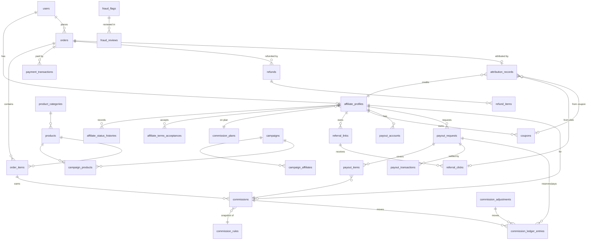

# Affiliate Management System: Phase 0 Discovery and Plan

Status: draft for review · 2026-10-09 · NPR · Asia/Kathmandu

This document is the Phase 0 deliverable from the master prompt (section 30). It covers the current state, proposed architecture, requirements checklist, initial database design, integration map, security threat assessment, implementation sequence and the first milestone.

---

## 1. Current-state assessment

What was inspected, and what was found:

| Area | Finding | How it was checked |
|---|---|---|
| Existing store codebase | **None confirmed.** GitHub account has a private repo named `Ecommerce` (last push Sept 2024) and others, but nothing identifies the live NFC store. | GitHub repo listing for `G2TheForce` |
| Local project folder | Not reachable yet (no folder on the user's computer connected to this thread). | Device connection check |
| Existing database | Unknown. No schema or dump supplied. | — |
| Product catalog / orders / checkout | Unknown. | — |
| Payment integrations | Unknown. eSewa and Khalti assumed as targets for Nepal. | Assumption |
| Hosting / deployment | Unknown. Spec targets Linux + Apache/Nginx, local Windows dev. | Spec |
| Build environment available to Claude | PHP 8.3.6, Composer, Node 22. No MySQL client installed (tests can use MySQL in Docker or SQLite for fast unit tests, with MySQL for the integration suite). | `php -v`, `node -v` in the cloud container |

**Working assumption until the user confirms otherwise:** this is a new application. The affiliate system ships with its own minimal product, order and payment modules, and every store-facing piece goes through an adapter interface so a real store can be plugged in later (Phase 7) without rewriting the commission engine.

If an existing store turns up, sections 4 and 5 change: the `products`, `orders`, `order_items` and payment tables are dropped from our migrations and replaced by adapters reading the store's tables.

---

## 2. Proposed architecture

### 2.1 Stack decision

| Layer | Choice | Why |
|---|---|---|
| Runtime | PHP 8.3 (8.2 minimum) | Matches Laravel 12 requirements; confirm the user's local and server PHP versions before Phase 1. |
| Framework | Laravel 12 | Current LTS-style release line with first-party Sanctum, queues, scheduler, policies. |
| Database | MySQL 8.0+ (InnoDB, utf8mb4) | Spec requirement; row locking (`SELECT … FOR UPDATE`) needed for payouts. |
| Auth | Laravel Sanctum (SPA cookie auth for web, personal access tokens for the future Flutter app) | Spec requirement. One API serves both. |
| Roles/permissions | `spatie/laravel-permission` | Mature, maintained, gives the `roles`/`permissions` tables the spec asks for. Only extra backend package planned for Phase 1. |
| Frontend | React 18 + TypeScript + Vite, served from the same Laravel app, talking only to `/api/v1` | Proves the API is complete (the Flutter app later uses the same contract). Tailwind CSS for design tokens. |
| Charts | Recharts | Lightweight, React-native. |
| Queue | `database` driver to start; Redis optional | Avoids extra infrastructure for ~100 affiliates. Switching is config-only. |
| Cache | `database` or `file` to start; Redis optional | Balances are never cached (spec section 23). |
| Tests | Pest (on PHPUnit) | Readable tests for business rules. |
| API docs | OpenAPI 3.1 YAML kept in `docs/api/openapi.yaml`, validated in CI | Machine-readable contract for Flutter. |
| Docker | Optional `docker-compose.yml` (app, mysql, queue worker, scheduler) | Spec section 26. |

### 2.2 Code layout (Laravel)

```
app/
  Domain/
    Affiliates/      Actions, Enums (AffiliateStatus), StateMachine, Policies
    Referrals/       AttributionService, AttributionPolicy (enum), ReferralCodeGenerator
    Commissions/     CommissionCalculator, RuleResolver, LedgerService, Enums
    Payouts/         PayoutService, PayoutProvider (interface), ManualPayoutProvider
    Orders/          OrderEventProcessor, OrderGateway (interface), LocalOrderGateway
    Payments/        PaymentGateway (interface), EsewaGateway, KhaltiGateway
    Fraud/           FraudSignalDetector, thresholds from settings
    Audit/           AuditLogger
  Http/
    Controllers/Api/V1/{Auth,Affiliate,Admin,Referral,Webhook}/   thin controllers
    Requests/        Form Requests
    Resources/       API Resources (never expose internal IDs or secrets)
  Jobs/ Events/ Listeners/ Notifications/
config/affiliate.php   all business defaults (window, holding period, thresholds)
database/migrations, factories, seeders (Dev* seeders guarded to local env)
resources/js/          React app (affiliate, admin, finance, support layouts)
docs/                  architecture, ADRs, API, guides
tests/Unit, tests/Feature, tests/Security
```

Business rules live in `config/affiliate.php` defaults, overridable from the `system_settings` table by a Super Administrator. Nothing like "30 days" or "14 days" is hardcoded in services.

### 2.3 Key architectural decisions (to be recorded as ADRs)

1. **Money** is stored as `BIGINT` minor units (paisa; NPR 1 = 100 paisa) plus a `CHAR(3)` currency column. Rates are stored as basis points (`10.00%` = `1000`). Rounding: half-up to the nearest paisa, applied once per commission line. No floats anywhere in financial code.
2. **Default attribution policy: last-click within a 30-day window**, with one explicit override: a valid affiliate coupon code entered at checkout wins over a stored click, because it is a deliberate customer action. Exactly one affiliate per order (no split allocation in v1). The policy name is snapshotted on every attribution record.
3. **Commission precedence** (first match wins, exclusions always win):
   1. Product or category exclusion → no commission
   2. Active campaign override (matching product and affiliate)
   3. Affiliate-specific override
   4. Product rule, then category rule
   5. Affiliate plan default
   6. Global default
   Overlapping rules at the same level are rejected at save time, so resolution is never ambiguous. The winning rule ID and version are snapshotted.
4. **Commissionable base**: line price after line discounts and a proportional share of order-level discounts; excludes VAT, shipping and payment fees unless enabled in settings. Refunds reduce the base per line.
5. **Ledger**: `commission_ledger_entries` is append-only (no UPDATE/DELETE grants on that table for the app's DB user in production; enforced also by model guards). Each entry moves an amount between buckets: `pending → approved → available → reserved → paid`, plus `reversed` and `adjustment`. Balances are SUMs over entries per affiliate and bucket. A nightly reconciliation job re-derives balances and flags any drift.
6. **Commission lifecycle**: `pending` (order paid) → `approved` (holding period of 14 days passed, no refund, no open fraud flag) → `available` → `paid`; side states `partially_reversed`, `reversed`, `on_hold`. Paid commissions that are later refunded create a negative adjustment (recoverable balance) rather than being deleted.
7. **Idempotency**: every external event goes through `webhook_events` with a unique `(provider, external_event_id)`. Commissions have a unique `(order_id, order_item_id, affiliate_id, type)`. Refund reversals have a unique `(refund_id, commission_id)`.
8. **Payouts**: manual payout provider first (finance staff pay via bank/eSewa/Khalti and record the reference and evidence). Automated disbursement adapters only after verifying each provider's merchant API capabilities.
9. **Notifications** are dispatched after the DB transaction commits (`afterCommit`), so an email outage cannot roll back or corrupt accounting.

---

## 3. Requirements checklist

Legend: P = phase in which it is delivered.

| # | Requirement | P |
|---|---|---|
| 1 | Laravel app setup, env config, error format, audit infrastructure | 1 |
| 2 | Registration, login, logout, password reset, email verification (Sanctum) | 1 |
| 3 | Roles: Super Admin, Affiliate Manager, Finance Manager, Support, Affiliate, Customer; permission matrix + tests | 1 |
| 4 | Admin bootstrap command (`php artisan affiliate:create-admin`, no default password) | 1 |
| 5 | Affiliate application, states (draft, pending, approved, rejected, suspended, deactivated), transition history | 2 |
| 6 | Admin review with internal notes; member notifications without internal notes | 2 |
| 7 | Affiliate profile, referral slug/code, terms acceptance history | 2 |
| 8 | Referral links (permanent, product, campaign), `/ref/{code}` redirect with allow-listed destinations | 3 |
| 9 | Click recording with minimal metadata (hashed IP, truncated UA), retention policy | 3 |
| 10 | Attribution (last-click, 30-day window, coupon override, manual staff attribution with reason) | 3 |
| 11 | Affiliate coupons with limits and stacking rules | 3 |
| 12 | Commission rules + precedence + versioning | 4 |
| 13 | Commission calculation, snapshots, ledger, balances, reversals, adjustments, reconciliation | 4 |
| 14 | Payout accounts (encrypted), requests, atomic reservation, review, mark-paid with evidence, failure release | 5 |
| 15 | Affiliate, admin and finance dashboards with DB-aggregated metrics and charts | 6 |
| 16 | Reports, CSV/XLSX exports (streamed, formula-injection safe, audited) | 6 |
| 17 | Products, campaigns, marketing assets (if no store catalog exists) | 3–6 |
| 18 | Order lifecycle events, eSewa/Khalti payment verification, refunds, disputes | 7 |
| 19 | Fraud signals, review queue, configurable thresholds | 4–8 |
| 20 | Security hardening, concurrency tests, performance checks, backups | 8 |
| 21 | Docs: install, deploy, backup/restore, admin guide, affiliate guide, API guide, release report | 9 |
| 22 | OpenAPI spec for Flutter | 1–9 (grows per phase) |

---

## 4. Initial database design

All money columns: `BIGINT` minor units + `currency CHAR(3)`. All tables have `created_at`/`updated_at` unless noted. Public identifiers are ULIDs or random codes; auto-increment IDs never appear in URLs.

### 4.1 Tables by area

**Identity and access**
- `users` – id, ulid (unique), name, email (unique), phone, password, email_verified_at, status, last_login_at, soft deletes
- `roles`, `permissions`, `model_has_roles`, `model_has_permissions`, `role_has_permissions` (spatie)
- `affiliate_profiles` – user_id (unique FK), public_id (unique), referral_code (unique), referral_slug (unique), display_name, status, commission_plan_id (FK), approved_at, country_code, promo_channels JSON, website_urls JSON
- `affiliate_status_histories` – affiliate_profile_id, from_status, to_status, actor_id, reason, internal_note (staff-only), created_at (append-only)
- `affiliate_terms_acceptances` – affiliate_profile_id, terms_version, accepted_at, ip_hash

**Referral and marketing**
- `referral_links` – affiliate_profile_id, code (unique), type (default/product/campaign), product_id?, campaign_id?, destination_path, utm JSON, is_active
- `referral_clicks` – referral_link_id, affiliate_profile_id, visitor_token_hash, ip_hash, user_agent_short, landing_path, clicked_at; index (affiliate_profile_id, clicked_at); purge after retention period (default 13 months)
- `attribution_records` – order_id (unique), affiliate_profile_id, source (click/coupon/manual), referral_click_id?, coupon_id?, campaign_id?, policy, attributed_at, actor_id?, reason?
- `campaigns`, `campaign_affiliates`, `campaign_products`
- `coupons` – code (unique), affiliate_profile_id?, type, value, min_order_minor, max_discount_minor, usage_limit, per_customer_limit, starts_at, ends_at, stackable, is_active
- `coupon_redemptions` – coupon_id, order_id (unique pair), customer_id
- `marketing_assets` – title, file_path (private disk), mime, size, visibility, campaign_id?

**Store (only while no external store exists)**
- `product_categories`, `products` (sku unique, slug unique, price_minor, status), `product_images`
- `orders` – number (unique), customer_id, status, payment_status, currency, subtotal/discount/tax/shipping/total_minor, placed_at, paid_at
- `order_items` – order_id, product_id, qty, unit_price_minor, line_discount_minor, allocated_order_discount_minor, tax_minor
- `payment_transactions` – order_id, provider, provider_ref (unique per provider), amount_minor, status, verified_at
- `refunds` – order_id, provider_ref, amount_minor, status, completed_at
- `refund_items` – refund_id, order_item_id, amount_minor
- `webhook_events` – provider, external_event_id, type, payload JSON, signature_valid, processed_at, attempts; **unique (provider, external_event_id)**

**Commission and accounting**
- `commission_plans` – name, default_rate_bp, is_default
- `commission_rules` – scope (global/plan/category/product/affiliate/campaign), scope_id, kind (percent/fixed/exclude), rate_bp?, fixed_minor?, currency?, starts_at, ends_at, is_active, version
- `commissions` – affiliate_profile_id, order_id, order_item_id, rule_id, rule_version, base_minor, rate_bp?, fixed_minor?, amount_minor, currency, status, eligible_at (holding period end), snapshot JSON; **unique (order_item_id, affiliate_profile_id)**
- `commission_adjustments` – commission_id?, affiliate_profile_id, amount_minor (signed), reason, actor_id, approved_by?, source_type/source_id
- `commission_ledger_entries` – affiliate_profile_id, commission_id?, adjustment_id?, payout_request_id?, refund_id?, from_bucket?, to_bucket, amount_minor, currency, idempotency_key (unique), created_at only (append-only)
- `payout_accounts` – affiliate_profile_id, method (bank/esewa/khalti), details (encrypted), verified_at, is_default
- `payout_requests` – public_id, affiliate_profile_id, payout_account_id, amount_minor, currency, status, idempotency_key (unique), reviewed_by, reviewed_at
- `payout_items` – payout_request_id, commission_id, amount_minor
- `payout_transactions` – payout_request_id, provider, reference (unique), evidence_path, confirmed_by, paid_at
- `financial_reconciliation_records` – run_at, scope, expected_minor, actual_minor, status, notes

**Operations**
- `audit_logs` – actor_id, action, subject_type, subject_id, before JSON, after JSON (secrets redacted), ip_hash, created_at (append-only)
- `fraud_flags` – affiliate_profile_id?, subject_type/id, signal, score, status, created_at
- `fraud_reviews` – fraud_flag_id, reviewer_id, decision, notes
- `system_settings` – key (unique), value JSON, updated_by
- `notifications` (Laravel), `jobs`, `failed_jobs`, `job_batches`, `personal_access_tokens`

### 4.2 Core ER diagram



### 4.3 Key indexes

- `affiliate_profiles(status)`, `(referral_code)`, `(referral_slug)`
- `referral_clicks(affiliate_profile_id, clicked_at)`
- `orders(status, paid_at)`, `(number)`
- `commissions(affiliate_profile_id, status, eligible_at)`, `(order_id)`
- `commission_ledger_entries(affiliate_profile_id, to_bucket)`, `(created_at)`
- `payout_requests(status, created_at)`, `(affiliate_profile_id, status)`
- `audit_logs(subject_type, subject_id)`, `(actor_id, created_at)`

---

## 5. Integration map

| Integration | Direction | Status | What is needed from the business |
|---|---|---|---|
| Store catalog / orders / checkout | Store → affiliate engine via `OrderGateway` | Built-in local store for now; real store connects in Phase 7 | Confirm whether an existing store exists |
| eSewa (customer payments) | Redirect + server-side signature and status verification | Interface + adapter in Phase 7; sandbox first | eSewa merchant account, product code, secret key |
| Khalti (customer payments) | Initiate + server-side lookup verification | Interface + adapter in Phase 7; sandbox first | Khalti merchant account, secret key |
| Affiliate payouts | Finance → affiliate | **Manual** process with recorded reference and evidence | Confirm which provider (if any) offers verified disbursement APIs for your merchant account |
| Email | App → affiliates/staff (queued) | SMTP in Phase 1; provider-agnostic | SMTP or transactional email provider credentials, sending domain with SPF/DKIM |
| SMS / WhatsApp | Optional | Interface only until a provider is chosen | Local SMS provider account (e.g. Sparrow SMS, Aakash SMS) if wanted |
| Shipping | Order status updates | Out of scope until a provider is named | Provider details |
| Flutter app | Consumes `/api/v1` with Sanctum tokens | API contract only in v1 | — |

Signatures, payloads and endpoints of eSewa and Khalti will be taken from their current official developer docs at implementation time, not from memory. No payment success is ever inferred from a browser redirect alone.

---

## 6. Security threat assessment

| Threat | Impact | Mitigation | Verified by |
|---|---|---|---|
| Duplicate/replayed payment webhook creates double commission | Financial loss | Unique `webhook_events(provider, external_event_id)`, unique `commissions(order_item_id, affiliate_profile_id)`, transaction around processing | Feature test: deliver same webhook twice |
| Concurrent payout requests spend the same balance | Financial loss | `SELECT … FOR UPDATE` on the affiliate's balance row/lock, reservation ledger entry in same transaction, idempotency key | Concurrency test with parallel requests |
| Refund reversed twice | Financial loss | Unique `(refund_id, commission_id)` on reversal ledger entries | Feature test |
| Forged payment confirmation via browser redirect | Financial loss | Server-side verification with provider before marking paid | Feature test with tampered callback |
| Admin silently edits balances | Fraud, loss of trust | No balance column to edit; append-only ledger; adjustments need reason + actor + audit log; optional two-person approval above a threshold | Security test |
| IDOR: affiliate reads another affiliate's data | Privacy breach | Policies on every route, scoped queries, ULIDs in URLs | Security tests per endpoint |
| Privilege escalation (affiliate approves self, changes payout status) | Fraud | Permission checks in policies and services, not just UI | Security tests |
| Open redirect via `/ref/{code}?to=` | Phishing | Destinations resolved from DB or an allow-list of internal paths only | Security test |
| Self-referral / multiple accounts | Fraud | Block when buyer email/user equals affiliate; fraud flags for shared payout details, device or address overlaps; hold not ban | Unit tests on detector |
| Click spam / bot traffic | Inflated stats | Rate limiting on `/ref`, bot UA filtering, unique-click dedupe by visitor token | Feature test |
| Payout detail hijack (account takeover then change bank) | Theft | Re-auth + email confirmation to change payout details, cooling-off period, fraud flag, audit | Feature test |
| Malicious file upload in marketing assets | RCE | Private disk outside web root, MIME + extension allow-list, served via authorized download controller | Security test |
| CSV formula injection in exports | Admin machine compromise | Prefix cells starting with `= + - @` with `'` | Unit test |
| Credential leakage | Full compromise | `.env` never committed, `.env.example` with placeholders, encrypted payout details, log redaction | Review + test on API resources |
| Brute-force login | Account takeover | Rate limits, lockout signals, optional admin TOTP MFA | Feature test |

### Nepal legal and tax notes (for qualified local review, not legal advice)

- Individual Privacy Act, 2075 (2018) and Electronic Transactions Act, 2063 (2008): consent, data minimization and disclosure in the privacy notice.
- Consumer Protection Act, 2075 (2018): no misleading earning claims on the affiliate landing page.
- Tax: commissions paid to affiliates may require TDS withholding and PAN collection; VAT treatment of sales. The system will support a configurable withholding line on payouts, but rates and obligations must be confirmed with a Nepal tax advisor.
- Multi-level commissions stay disabled unless a lawyer confirms they are permissible.

---

## 7. Implementation sequence

Follows section 30 of the master prompt exactly: Phase 1 Foundation → 2 Onboarding → 3 Referral tracking → 4 Commission accounting → 5 Payouts → 6 Dashboards and reporting → 7 Store and payment integration → 8 Security and performance → 9 Release. Each phase ends with tests run and results reported before the next starts.

Because no existing store is confirmed, a minimal local product/order module is built in Phase 3–4 (enough to place and pay test orders through a gateway interface), so attribution and commissions can be tested end to end before real payment providers are connected in Phase 7.

---

## 8. First milestone: Phase 1 Foundation

**Objective:** a running Laravel 12 app with authentication, roles, admin bootstrap, audit logging and a passing test suite, buildable on Windows and Linux.

**Scope**
1. New Laravel 12 project in a Git repository (new private GitHub repo, or the one the user names).
2. `.env.example` with placeholders only, `.gitignore`, `config/affiliate.php` with NPR / Asia/Kathmandu defaults.
3. MySQL configuration (and Docker Compose for local MySQL if not installed on Windows).
4. Sanctum: register, login, logout, me, email verification, forgot/reset password under `/api/v1/auth`.
5. Roles and permissions seeded (6 roles, permission matrix in `docs/permissions-matrix.md`).
6. `php artisan affiliate:create-admin` interactive command (no default password).
7. Standard JSON error and validation response format; production hides stack traces.
8. `audit_logs` table and `AuditLogger` service, used by auth events.
9. Rate limiting on auth routes; security headers middleware.
10. React + TypeScript + Vite shell with login, register, and empty affiliate and admin layouts.
11. Pest tests: auth flows, role enforcement (customer and affiliate blocked from admin routes), admin bootstrap, audit entries written.
12. Initial `docs/architecture.md`, ADRs for money, attribution and ledger decisions, and `docs/local-setup-windows.md`.

**Acceptance criteria**
- `composer install && php artisan migrate --seed && php artisan test` passes from a clean checkout.
- `npm run build` and `npm run typecheck` pass.
- A user can register, verify email (via log mailer locally) and log in; an admin created by the command can reach `/api/v1/admin/ping` and a customer cannot (403).
- No secrets in the repository.

**Needed from the user before Phase 1 code is pushed**
- Answer to the existing-codebase question.
- Where the code should live (a new private GitHub repo is the default).
- PHP version on their Windows machine and on the production server, if known.
